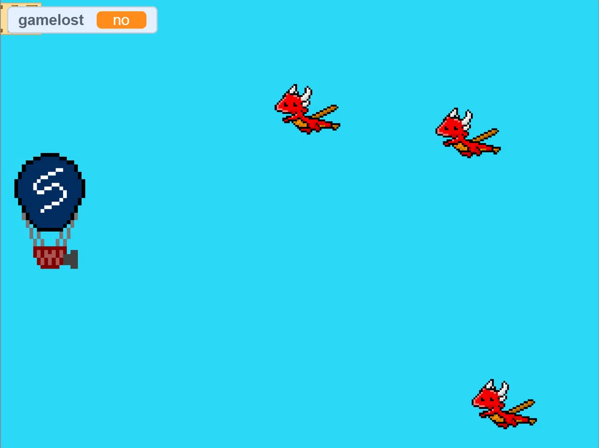
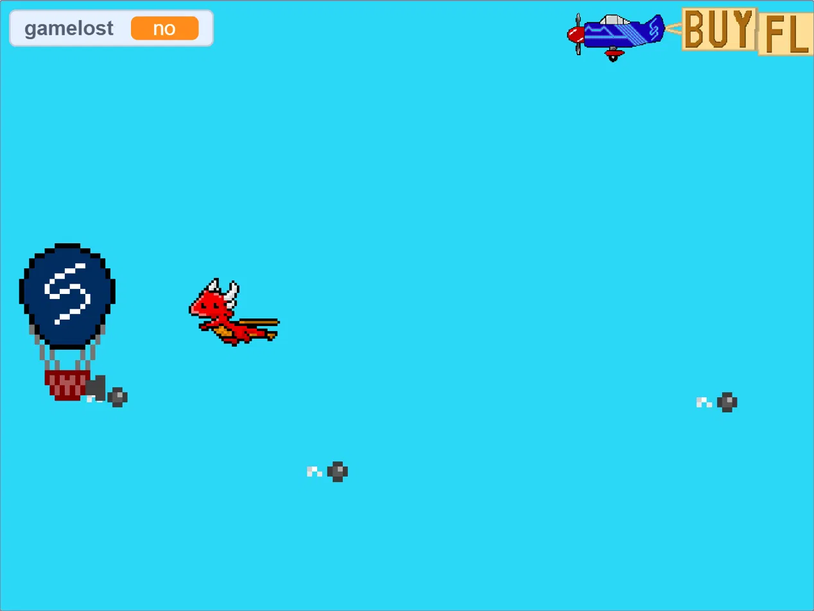
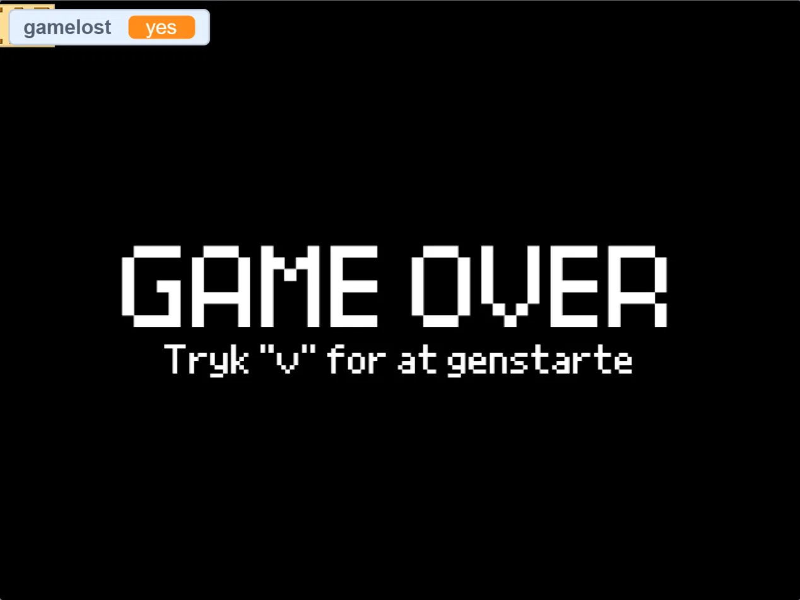

# Flow Wear Ad Game 🎈🐉

An advertising game for the fictional sportswear company **Flow Wear**, built in [Scratch](https://scratch.mit.edu/) as a school project in **Informatics (3.g)** at a Danish upper secondary school (*gymnasium*).

You fly a Flow Wear hot air balloon, shoot cannonballs at attacking dragons, and survive as long as you can, while a propeller plane tows a Flow Wear banner across the sky.

| Gameplay | Banner plane | Game over |
|---|---|---|
|  |  |  |

## The case

Flow Wear makes clothing with built-in electronics that measure movement, posture, heart rate, hydration and more. The company asked us to develop an ad game that:

- engages their customers and creates awareness around the brand and its products,
- appeals to their current target group (young athletes), while staying open to reaching other audiences,
- can be published on the company website and on their social media pages.

The original brief (in Danish) is in [`docs/case-brief-da.pdf`](docs/case-brief-da.pdf). An English summary is in [`docs/case-brief.md`](docs/case-brief.md).

## How to play

| Key | Action |
|---|---|
| `W` | Fly up |
| `S` | Fly down |
| `Space` | Fire a cannonball |
| `V` | Restart after game over |

The balloon uses simple momentum-based movement, so it accelerates and glides rather than moving in fixed steps. Dragons fly in and home in on the balloon. Hit them with cannonballs before they touch you. If a dragon touches the balloon, the game is over.

## Run the game

**Online editor (easiest)**

1. Go to <https://scratch.mit.edu/projects/editor/>
2. Choose **File → Load from your computer**
3. Select [`src/flow-wear-ad-game.sb3`](src/flow-wear-ad-game.sb3)
4. Click the green flag

**Offline:** open the `.sb3` file in the [Scratch desktop app](https://scratch.mit.edu/download).

## Repository structure

```
flow-wear-ad-game/
├── src/
│   └── flow-wear-ad-game.sb3     # The finished game (Scratch 3 project)
├── assets/
│   └── sprites/                  # Exported sprites, reusable in other projects
│       ├── cannonball.sprite3
│       ├── dragon.sprite3
│       └── banner-plane.sprite3
├── docs/
│   ├── case-brief-da.pdf         # Original assignment (Danish)
│   ├── case-brief.md             # English summary of the assignment
│   ├── game-design.md            # How the game is built
│   └── screenshots/
├── CHANGELOG.md
├── LICENSE
└── README.md
```

## Under the hood

A short overview is below, with more detail in [`docs/game-design.md`](docs/game-design.md).

- **Sprites:** Balloon (player), Dragon1-3 (enemies), Cannonball (projectile, created as clones), Propeller plane (banner advertising Flow Wear)
- **Backdrops:** sky (gameplay) and a black game-over screen
- **Communication:** sprites coordinate through Scratch broadcasts such as `dragon begin`, `kill1`-`kill3` and `game lost`
- **State:** global variables such as `gamelost`, `kills` and `Game status`
- **Custom blocks:** used in the balloon and cannonball sprites to keep movement and collision logic readable

## Marketing idea

The game keeps the brand in front of the player at all times: the balloon carries the Flow Wear logo, and the banner plane flies a Flow Wear message across the screen. The gameplay is quick to learn and easy to replay, which suits sharing on social media.

## Team

<!-- Replace with your own names -->
- *Name 1*
- *Name 2*
- *Name 3*

Informatics, 3.g, *School name*, 2025

## License

Code and project files are released under the [MIT License](LICENSE). The Flow Wear name and logo belong to the fictional case company used in the assignment and are included for educational purposes only. Some Scratch library assets (e.g. sounds and base sprites) are provided by the Scratch Foundation under their own terms.
